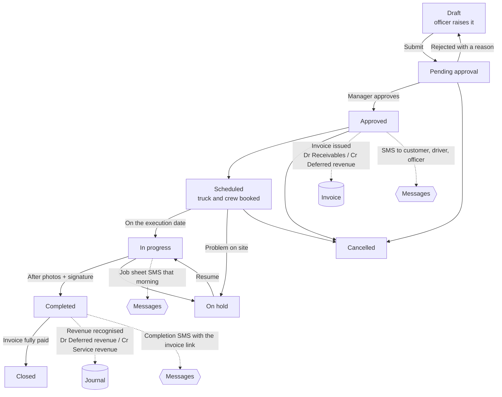
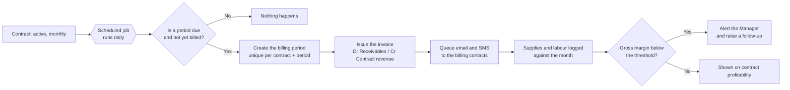

# FacilitiesManagement

An operations, fleet, billing and accounting system for a facility services company in Ghana.
Built with React, TypeScript, Vite and Tailwind on the front, Supabase (PostgreSQL, Auth, Storage,
Realtime and Edge Functions) behind it.

Everything that matters to the money happens in the database: document numbers, status changes,
totals, tax, ledger postings and balance checks are Postgres functions and triggers, protected by
Row Level Security. The browser cannot skip a step, and nothing posted is ever edited or deleted.

- Currency: Ghana cedi, shown as `GH₵ 1,250.00`
- Dates: DD/MM/YYYY · Time zone: Africa/Accra (UTC)
- Phone numbers stored as `233XXXXXXXXX`, typed in any local form
- Ghana Card `GHA-XXXXXXXXX-X` and GhanaPost GPS `GA-123-4567` validated on entry

Before you start, replace the three placeholders from the brief: **[COMPANY NAME]** in
Settings → Company, **[SMS SENDER ID]** in Settings → Company and with your SMS provider, and
**[BRAND COLOUR]** in Settings → Company (it drives the whole interface and every PDF).

---

## 1. Overview and feature list by module

### Customers
Individuals and companies in one register, each with a code, Ghana Card or TIN, GPS address,
photo, documents, contacts and consent for data use under Act 843. Duplicate detection on phone and
name before saving. A full profile page with timeline, jobs, contracts, invoices, payments,
statement, documents and surveys. Import from CSV or Excel with a column mapper and a dry run.

### Leads and pipeline
Leads from calls, walk-ins, the field, zonal officers, referrals and the website. Kanban pipeline
with drag between stages, activity log, reminders, conversion to a customer (keeping the history),
and a lost reason that is required before a lead can be closed.

### Services and the estimator
Six services with their own units of measure (per trip, per day, per cabin per day, per m², per
visit, per month, per event). A cost item catalogue with dated prices. The estimator prices a job
from its real costs — consumables, equipment, labour, vehicle, subcontract and overhead — adds
overhead and contingency as percentages, and shows the margin live as you type. A price below cost
is blocked with a red warning; a price below the target margin needs a Manager's approval.
Versioning, templates per service, and conversion into a job order or a contract that keeps the link
so the estimate can later be compared with what the work actually cost.

### Job orders
Raise → submit → approve → scheduled → in progress → completed → closed, with hold, resume, cancel
and reject. The truck picker only offers trucks that are on the road and free on the date; the
database refuses an overlapping booking. Approval issues the invoice and queues the messages to the
customer, the driver and the officer. Completion needs after-photos and the customer's signature,
recognises the revenue, and records the resources actually used so the job's true profit is known.
Dispatch calendar by day, week or month, one row per truck.

### Fleet
Trucks with status (On Road, On Job, Off Road with a reason and an expected return), documents with
expiry reminders, preventive maintenance schedules and records, fuel logs with consumption, drivers
and crew, and a booking calendar. Setting a booked truck to Off Road flags every future job it was
on and alerts the officer in charge.

### Contracts
Recurring and one-off. Sites, services, labour and the supplies the contract includes. Monthly
billing runs on its own schedule and can never double-bill a period. Supplies and labour logged
against the contract give the real gross profit and margin per month; a month below the threshold
raises an alert.

### Supplies and stock
Stock locations, levels and every movement in and out, received on supplier bills and issued to jobs
and contracts, each movement posting to the ledger.

### Invoices, payments and receipts
Invoices from jobs, contracts or raised by hand, with tax from the configurable rates and a public
link the customer can open without logging in. Payments by cash, MTN MoMo, Telecel Cash, AT Money,
bank transfer, cheque or card; part payments, over-payments held as customer credit, allocation
across invoices, receipts, credit notes and refunds. Statements per customer. Optional online
payment through Paystack or Hubtel.

### Accounting
A Ghana SME chart of accounts, double-entry journals posted by the database from a configurable
posting-rules table, supplier bills and expenses with their own approval, bank and MoMo accounts
with reconciliation, and eight reports: profit and loss, balance sheet, trial balance, general
ledger, cash flow, receivables and payables ageing, tax summary and expenses by category — each
exportable to Excel and PDF.

### Surveys
A short survey sent with every receipt, opened by link without a login, one response per link. A low
score creates a follow-up task for the Manager automatically.

### Zonal officer tracker
Officers plan a day or a week on their phone, check in with GPS at each stop, record the outcome and
turn a good conversation into a lead. It works with no signal: updates queue on the device and send
themselves when the connection comes back. The Manager sees the board, the completion rate per
officer and the check-ins on a map, live.

### Executive dashboard
Revenue, receivables, cash, job and fleet status, margins, top customers and pipeline — every figure
agrees with the report behind it, and every chart drills down to the list.

### Settings
Company profile, users and roles, tax rates, every message template, approval and margin thresholds,
document numbering, scheduled job times, the audit log, and data export.

---

## 2. Prerequisites

| What | Why | Notes |
|---|---|---|
| Node.js 20 LTS or later, with npm | Builds the front end | `node -v` must print v20 or higher |
| A Supabase account and project | Database, auth, storage, functions | The free plan is enough to start |
| Supabase CLI (optional but recommended) | Runs the migrations and deploys functions | `npm i -g supabase` |
| An SMS account: Hubtel, Arkesel or mNotify | Job alerts, reminders, invoice messages | You also register the sender ID with them |
| An email account: Resend or any SMTP server | Invoices, receipts, statements | |
| A Paystack or Hubtel merchant account (optional) | Letting customers pay an invoice online | Leave it off until you need it |

---

## 3. Supabase setup, step by step

**1. Create the project.** In the Supabase dashboard choose New project, pick a strong database
password and the region closest to Ghana (`eu-west-1` or `eu-central-1` are the usual choices).

**2. Copy the URL and the publishable key.** The quickest route is the project's **Connect** dialog,
which shows both ready to paste; otherwise open **Settings → API Keys**. You need the project URL
(`https://<project-ref>.supabase.co`) and, under the *Publishable and secret API keys* tab, the
**publishable key** (`sb_publishable_…`). If that tab offers a *Create new API keys* button, your
project is still on the older keys: either create them, or take the legacy `anon public` key from
the *Legacy API Keys* tab — both work identically here, since each runs as the `anon` Postgres role
and is governed by the same RLS policies. Supabase is retiring the legacy keys at the end of 2026,
so prefer the publishable one for a new project.

Whichever you copy goes into `VITE_SUPABASE_ANON_KEY`; the variable name is just what this codebase
calls it. The **secret** key (`sb_secret_…`) and the legacy `service_role` key bypass RLS entirely
and must never appear in `.env` or anywhere the browser can reach.

**3. Enable pg_cron and pg_net.** Database → Extensions, search for each and enable it. Migration
`0001` enables them too where it is allowed to, and prints a notice if it cannot; if the notice
appears, enable them here and then run `select public.schedule_app_jobs();`.

**4. Run the migrations.** Either way works, and both are tested.

With the CLI:

```bash
supabase login
supabase link --project-ref <your-project-ref>
supabase db push          # applies supabase/migrations in file order
```

Through the dashboard: open SQL Editor and paste the contents of each file in
`supabase/migrations/`, in order 0001 → 0019, running each one before the next. They are written to
be re-runnable (`create ... if not exists`, `create or replace`, `drop policy if exists`), so running
one twice is harmless.

**5. Run the seed.** `supabase db reset` runs it for a local database. On a hosted project, paste
`supabase/seed.sql` into the SQL editor and run it. It loads the roles, services, task types, tax
rate placeholders (inactive until you set your own rates), payment methods, the chart of accounts
and posting rules, document sequences, company settings and every message template — then, in a
clearly marked block at the end, the demo data.

Everything between the `-- DEMO DATA START` and `-- DEMO DATA END` markers is sample data. Delete
those lines before running the file on a production project, or load it to try the system out and
clear it later with the block in "Removing the demo data" below.

**6. Check the storage buckets.** Storage should list six private buckets and one public one:
`customer-documents`, `job-photos`, `fleet-documents`, `expense-receipts`, `task-evidence` and
`contracts` (all private), plus `branding` (public, for the logo). Migration `0017` creates them. If
your project blocked that, create them by hand with exactly those names, private except `branding`,
with a 5 MB limit (10 MB for `contracts`, 2 MB for `branding`).

**7. Enable Realtime.** Migration `0018` adds these tables to the `supabase_realtime` publication:
`job_orders`, `invoices`, `payments`, `trucks`, `tasks`, `task_comments`, `task_checkins`,
`in_app_notifications`. Check them under Database → Replication. Realtime respects RLS, so each
person only receives the rows their policies already allow.

**8. Auth settings.** Authentication → URL Configuration:

- Site URL: your deployed address, e.g. `https://app.yourdomain.com`
- Redirect URLs: add `https://app.yourdomain.com/reset-password` and, for local work,
  `http://localhost:5173/reset-password`
- Under Email templates, edit Invite user and Reset password so they carry your company's name.
- Leave email confirmation on. Turn off public sign-ups (Authentication → Providers → Email →
  disable "Enable sign ups") once your team is invited: people join by invitation only.

**9. Deploy the Edge Functions and set the secrets.**

```bash
supabase functions deploy send-notification
supabase functions deploy payment-webhook
supabase functions deploy invite-user
supabase functions deploy public-document
supabase functions deploy public-survey

supabase secrets set \
  SMS_PROVIDER=hubtel HUBTEL_CLIENT_ID=... HUBTEL_CLIENT_SECRET=... SMS_SENDER_ID=YOURNAME \
  EMAIL_PROVIDER=resend RESEND_API_KEY=... EMAIL_FROM="Your Company <billing@yourdomain.com>" \
  PAYMENT_PROVIDER=paystack PAYSTACK_SECRET_KEY=... \
  CRON_SECRET="$(openssl rand -hex 32)" PUBLIC_APP_URL=https://app.yourdomain.com
```

`SUPABASE_URL` and `SUPABASE_SERVICE_ROLE_KEY` are given to the functions automatically — do not set
them yourself. Every secret the functions can take is listed in `.env.example`.

**10. Store the cron secret and the function URL in Vault.** The scheduled jobs call
`send-notification` through `pg_net`, and they read the address and the secret from Vault so neither
is ever written into a table:

```sql
select vault.create_secret('https://<your-project-ref>.supabase.co/functions/v1', 'fm_functions_url');
select vault.create_secret('<the same CRON_SECRET you set above>', 'fm_cron_secret');
select public.schedule_app_jobs();
```

**11. Check the cron jobs.**

```sql
select jobname, schedule, active from cron.job order by jobname;
```

You should see `fm-process-outbox` (every minute) plus one job for each time set in
Settings → Configuration. Changing those times and choosing **Apply times** re-schedules them.

---

## 4. Creating the first Super Admin

Sign up or invite the person first (Authentication → Users → Invite user), then run this once,
with their email address:

```sql
-- Give an existing signed-up user the Super Admin role.
with p as (
  select pr.id
  from public.profiles pr
  join auth.users u on u.id = pr.user_id
  where lower(u.email) = lower('you@yourcompany.com')
)
insert into public.user_roles (profile_id, role_code)
select p.id, 'super_admin' from p
on conflict (profile_id, role_code) do nothing;
```

If the profile does not exist yet — which happens only if the trigger was blocked — create it first:

```sql
insert into public.profiles (user_id, full_name, email)
select u.id, coalesce(u.raw_user_meta_data->>'full_name', split_part(u.email, '@', 1)), u.email
from auth.users u
where lower(u.email) = lower('you@yourcompany.com')
  and not exists (select 1 from public.profiles p where p.user_id = u.id);
```

From then on, everyone else is invited from **Settings → Users**, which sets their roles and zones
in the same step.

### Linking the demo profiles to real sign-ins

The demo data deliberately creates **no Auth users**, so nobody can sign in as a demo person. Each
demo profile carries an `@demo.fm` email address instead, and the sign-up trigger links a new
account to a waiting profile with the same address. So to step into a demo role while you are
learning the system, invite that exact address — for example `ops@demo.fm` — from Supabase
Authentication, accept the invitation, and the demo person's history is yours.

For your real team, do the opposite: invite them on their real addresses from Settings → Users, and
leave the demo profiles alone until you remove the demo data.

### Removing the demo data

The cleanest route is not to load it: delete the lines between the two `DEMO DATA` markers before
you run `seed.sql` on the project that will hold your real work.

If you already loaded it and have not yet entered anything real, clear the transactional tables and
keep the reference data. **Only ever do this before real data exists** — it empties the tables named,
whatever is in them:

```sql
begin;
truncate table
  public.task_checkins, public.task_updates, public.task_comments, public.tasks, public.task_plans,
  public.survey_answers, public.survey_responses, public.survey_invitations,
  public.payment_allocations, public.receipts, public.refunds, public.credit_notes,
  public.customer_credit_applications, public.customer_credits, public.payments,
  public.invoice_taxes, public.invoice_lines, public.invoices,
  public.journal_lines, public.journal_entries, public.bank_transfers,
  public.bill_payments, public.bill_lines, public.bills,
  public.expenses, public.stock_movements, public.stock_levels,
  public.contract_billing_periods, public.contract_supplies, public.contract_labour,
  public.contract_services, public.contract_sites, public.contracts,
  public.job_order_actual_costs, public.job_order_photos, public.job_order_status_history,
  public.job_order_assignments, public.job_order_lines, public.job_orders,
  public.truck_bookings, public.employee_bookings, public.maintenance_records,
  public.maintenance_schedules, public.fuel_logs, public.truck_status_history, public.truck_documents,
  public.trucks, public.employees,
  public.quotations, public.estimate_lines, public.estimates,
  public.lead_activities, public.leads, public.customer_documents, public.customer_contacts,
  public.customers, public.followup_tasks, public.notifications, public.in_app_notifications,
  public.public_links, public.payment_sessions, public.audit_log
restart identity cascade;

delete from public.profiles where is_demo and user_id is null;
update public.document_sequences set last_value = 0;
commit;
```

Services, cost items, tax rates, accounts, posting rules, templates and your own users are
untouched. Zones are kept too; remove any demo ones from Settings → Zones.

---

## 5. Running it locally

```bash
npm install
cp .env.example .env        # then fill in VITE_SUPABASE_URL and VITE_SUPABASE_ANON_KEY
npm run dev                 # http://localhost:5173
```

Other commands:

```bash
npm run build       # type-checks, then builds into dist/
npm run preview     # serves the built files, to check the production bundle
npm run typecheck   # types only, no build
npm run lint        # eslint
```

A full local stack, if you have Docker and the CLI:

```bash
supabase start      # local Postgres, Auth, Storage and Studio
supabase db reset   # migrations + seed, from scratch
supabase functions serve send-notification --env-file .env.functions
```

---

## 6. Deployment

### Vercel

1. Push the repository to GitHub, then Vercel → Add New → Project → import it.
2. Framework preset: **Vite**. Build command `npm run build`, output directory `dist`.
3. Settings → Environment Variables, for Production and Preview. Only two are required:
   `VITE_SUPABASE_URL` and `VITE_SUPABASE_ANON_KEY` (step 2 above says where to find them).
   `VITE_APP_NAME` and `VITE_PUBLIC_APP_URL` are optional — left unset they fall back to
   "FacilitiesManagement" and to whatever address the app is being served from.
4. Deploy. `vercel.json` already rewrites every path to `index.html`, which a single-page app needs,
   and sets the security headers.

### Netlify

1. Netlify → Add new site → Import an existing project.
2. Build command `npm run build`, publish directory `dist`.
3. Site configuration → Environment variables: the same `VITE_` values as above.
4. Deploy. `netlify.toml` carries the SPA redirect and the same headers.

### A custom domain

1. Add the domain in Vercel (Settings → Domains) or Netlify (Domain management) and follow the DNS
   records they give you.
2. Wait for the certificate, then update **three** places or links will break:
   - Supabase → Authentication → URL Configuration: Site URL and the `/reset-password` redirect
   - the `PUBLIC_APP_URL` function secret: `supabase secrets set PUBLIC_APP_URL=https://app.yourdomain.com`
   - Settings → Company → Public app address, which is what goes into customer links
3. If you use online payments, set the same domain as the callback URL in your Paystack or Hubtel
   dashboard, and the webhook to
   `https://<project-ref>.supabase.co/functions/v1/payment-webhook?provider=paystack`.

---

## 7. Roles and permissions

**F** everything · **A** create, edit and approve · **C** create and edit · **V** view only ·
**O** only their own records · **·** no access

| Area | Super Admin | Manager | Ops Officer | Sales Exec | Zonal Officer | Accountant | Fleet Manager | Driver | Executive |
|---|---|---|---|---|---|---|---|---|---|
| Customers | F | C | C | C | C | V | · | · | V |
| Leads and pipeline | F | C | V | C | O | · | · | · | V |
| Estimates and quotes | F | A | C | C | · | V | · | · | V |
| Job orders: raise | F | C | C | C | · | V | V | O | V |
| Job orders: approve | F | A | · | · | · | · | · | · | · |
| Job orders: start and complete | F | C | C | · | · | · | · | O | V |
| Fleet and maintenance | F | V | V | · | · | V | F | O | V |
| Contracts and recurring billing | F | A | C | C | · | C | · | · | V |
| Supplies log | F | V | C | · | · | V | · | · | V |
| Invoices, payments, receipts | F | V | V | V | · | F | · | · | V |
| Accounting and expenses | F | A | · | · | · | F | C | · | V |
| Zonal task tracker | F | F | · | · | O | · | · | · | V |
| Surveys | F | C | V | V | · | · | · | · | V |
| Executive dashboard | F | V | · | · | · | V | · | · | V |
| Settings, users, templates | F | · | · | · | · | · | · | · | · |
| Audit log | F | V | · | · | · | V | · | · | V |

Two rules sit on top of the matrix:

- **Segregation of duties.** Whoever raises a document cannot approve it, even a Manager, even a
  Super Admin. It is on by default and can be turned off in Settings → Configuration for a very
  small team, which the system records in the audit log.
- **Zones.** A zonal officer only sees customers, leads and tasks in the zones assigned to them.

This is enforced by Row Level Security and by `require_role()` inside every workflow function, not
by hiding buttons. Signing in and calling the API directly gives exactly the same answers.

---

## 8. Workflow guides

### Job order lifecycle



The approval issues the invoice but holds the revenue in **Deferred revenue** — the money is owed,
but the work has not been done. Completion moves it to **Service revenue**. That is why a cancelled
job before completion leaves no revenue behind, and why the profit and loss only ever shows work
actually delivered.

### Recurring billing



The uniqueness is a database constraint on the contract and the period, not a check in code, so
running the generator twice on the same day creates exactly one invoice. Running it by hand from
Contracts → Upcoming bills is therefore always safe.

### Payment → receipt → survey

```mermaid
sequenceDiagram
    participant C as Customer
    participant A as Accountant
    participant DB as Database
    participant F as Edge Function
    A->>DB: record_payment(amount, method, allocations)
    DB->>DB: Dr Cash/Bank/MoMo · Cr Accounts receivable
    DB->>DB: Allocate to invoices, oldest first
    DB->>DB: Any excess becomes a customer credit
    DB->>DB: Issue the receipt and its public link
    DB->>DB: Create the survey invitation and its link
    DB->>DB: Queue the SMS and the email
    F->>DB: claim_notifications() every minute
    F->>C: SMS and email with the receipt and survey links
    C->>F: Opens the survey, no login needed
    F->>DB: One response only; link then closed
    DB->>DB: Score at or below the threshold → Manager follow-up
```

---

## 9. SMS and email

### Switching providers

The provider is chosen in **Settings → Configuration** and the keys live in Edge Function secrets.
Three SMS providers are built in — Hubtel, Arkesel and mNotify — and each needs its own keys:

```bash
# Hubtel
supabase secrets set SMS_PROVIDER=hubtel HUBTEL_CLIENT_ID=... HUBTEL_CLIENT_SECRET=...
# Arkesel
supabase secrets set SMS_PROVIDER=arkesel ARKESEL_API_KEY=...
# mNotify
supabase secrets set SMS_PROVIDER=mnotify MNOTIFY_API_KEY=...
```

Email is Resend (`RESEND_API_KEY`) or any SMTP server (`SMTP_HOST`, `SMTP_PORT`, `SMTP_SECURE`,
`SMTP_USER`, `SMTP_PASS`), with `EMAIL_FROM` as the visible sender.

### Registering the sender ID

The sender ID is the name that appears instead of a phone number. It is at most 11 characters, and
every Ghanaian provider must register it with the networks before it works — allow a few working
days. Until it is approved, messages either fail or arrive from a shortcode. Set the same value in
two places: `SMS_SENDER_ID` in the function secrets, and Settings → Company → SMS sender ID.

### Editing the wording

**Settings → Messages** holds every template, in SMS and, where it fits, email. Each one shows a
live preview with sample values and counts the message parts: an SMS over 160 characters (70 if it
contains anything outside the GSM alphabet) is charged as more than one. Click a placeholder to
insert it; anything in braces that is not a known placeholder is flagged before you can save.

Transactional messages — job confirmations, invoices, receipts, reminders — always send. Marketing
messages, such as birthday greetings, only go to customers who agreed to them.

### Testing

**Settings → Messages → Send a test SMS** queues a message to any number, exactly like a real one,
and the scheduled function sends it within a minute. If it does not arrive, Notifications shows the
provider's own error against that message. That single test proves the keys, the sender ID, the
scheduler and the function are all working.

---

## 10. Accounting notes

Every financial event posts a balanced double entry, written by the database from the
`posting_rules` table. Change an account there and later postings follow it; postings already made
never move.

| Event | Debit | Credit |
|---|---|---|
| `job_approved` | Accounts receivable | Deferred revenue (tax to each tax account) |
| `job_completed` | Deferred revenue | The service's own revenue account |
| `contract_invoice` | Accounts receivable | Contract revenue |
| `manual_invoice` | Accounts receivable | Service revenue or Other income |
| `invoice_tax` | — | Each tax's own account (fallback: Tax payable) |
| `payment_received` | The cash, bank or MoMo account received into | Accounts receivable |
| `customer_overpayment` | Cash or bank | Customer credits |
| `credit_applied` | Customer credits | Accounts receivable |
| `credit_note` | Revenue (or Deferred revenue before completion) and tax | Accounts receivable |
| `refund` | Customer credits | The cash or bank account paid from |
| `bill_approved` | Each bill line's expense account, or Inventory if stocked | Accounts payable |
| `bill_paid` | Accounts payable | The account paid from |
| `expense_approved` | The expense account | Accounts payable |
| `expense_paid` | Accounts payable | The account paid from |
| `stock_receipt` | Consumables inventory | Accounts payable |
| `stock_issue` | Consumables | Consumables inventory |
| `maintenance` | Vehicle maintenance | Accounts payable or the account paid from |
| `fuel_purchase` | Fuel | Cash on hand or the account paid from |
| `bank_charges` | Bank and MoMo charges | The source account |
| `bank_transfer` | Destination account | Source account |
| `manual` | Entered by the Accountant | Must balance before it will post |

House rules:

- Money is `numeric(14,2)`, quantities `numeric(12,3)`. No floats anywhere. Rounding happens at line
  level, then lines are summed, so the total always equals the sum of what is printed.
- A posted invoice, payment, receipt or journal is never edited or deleted. Corrections are a credit
  note, a refund or a reversing journal, each pointing at what it corrects.
- Tax rates are never hard-coded. They come from `tax_rates`, in order, with compounding where you
  set it, and the rate that applied on the day stays on the document for ever.
- Lock the books up to a date in Settings → Configuration and nothing on or before it can be posted,
  changed or reversed.
- `select * from public.v_trial_balance;` should always show equal debits and credits. The
  acceptance tests check this after every scenario.

---

## 11. Troubleshooting

**"Permission denied" or "new row violates row-level security policy".**
The person's role does not allow it, or their profile has no role at all. Check with:

```sql
select pr.full_name, u.email, array_agg(ur.role_code) as roles, pr.is_active
from public.profiles pr
left join auth.users u on u.id = pr.user_id
left join public.user_roles ur on ur.profile_id = pr.id
group by pr.full_name, u.email, pr.is_active order by pr.full_name;
```

A brand-new user with no role lands on "No role assigned yet" by design. Assign one in
Settings → Users. If a zonal officer cannot see a customer, check their zones — that is the usual
cause.

**Cron jobs are not firing.**

```sql
select jobname, schedule, active from cron.job;
select jobname, status, return_message, start_time
from cron.job_run_details order by start_time desc limit 20;
```

If the list is empty, `pg_cron` is not enabled: enable it under Database → Extensions, then
`select public.schedule_app_jobs();`. If jobs run but nothing is sent, the Vault secrets are
missing or wrong — re-run the two `vault.create_secret` calls from step 10 and confirm `CRON_SECRET`
matches the function secret exactly. Remember the times are UTC, which is Ghana time.

**SMS is not arriving.**
Open Notifications and look at the failed message: the provider's own error is recorded against it.
The usual causes are an unregistered sender ID, no credit with the provider, a wrong key, or a
number that is not a real Ghana mobile. Every number is normalised to `233XXXXXXXXX` before sending,
so a number saved as `024...` is fine.

**CORS errors in the browser console when calling a function.**
Set `ALLOWED_ORIGIN` to your exact site address (`https://app.yourdomain.com`, no trailing slash) and
redeploy the function. Each function answers the `OPTIONS` preflight itself; a 401 on the preflight
means you are calling it without the publishable (or anon) key.

**"Invoice not found" on a public link.**
The link only works once the invoice has left draft, and statement links expire — generate a fresh
one from the customer's Statement tab.

**The build fails with a type error after you change the database.**
Regenerate the types: `supabase gen types typescript --linked > src/types/database.ts`.

---

## 12. Screenshots

Replace each placeholder with a real screenshot once your own data is in. Keep them in
`docs/screenshots/`.

### Sign in
_(screenshot)_
### Executive dashboard
_(screenshot)_
### Customer profile
_(screenshot)_
### Lead pipeline
_(screenshot)_
### Estimate builder
_(screenshot)_
### Job order detail
_(screenshot)_
### Dispatch calendar
_(screenshot)_
### Fleet and truck detail
_(screenshot)_
### Contract profitability
_(screenshot)_
### Invoice and public invoice link
_(screenshot)_
### Payments and receipt
_(screenshot)_
### Accounting reports
_(screenshot)_
### Survey, as the customer sees it
_(screenshot)_
### Zonal officer, on a phone
_(screenshot)_
### Zonal manager board and map
_(screenshot)_
### Settings
_(screenshot)_

---

## 13. Backup, security and data protection

### Backup

- Supabase takes daily backups on paid plans. Check Database → Backups and know your retention.
- Take your own copy before anything risky:
  `supabase db dump --db-url "$DATABASE_URL" -f backup-$(date +%F).sql`
- Settings → Data export produces an Excel workbook of any group of tables, or a CSV of one table,
  straight from your account — useful for your accountant and as an off-site copy.
- Uploaded files live in Storage and are **not** in a database dump. Download them separately
  (`supabase storage download`) or copy the buckets.
- Test a restore into a spare project at least once a year. A backup you have never restored is a
  guess, not a backup.

### Security

- The browser only ever holds the publishable (or legacy anon) key, which is useless without a session and is governed by
  RLS. The service-role key exists only inside Edge Function secrets.
- SMS, email and payment keys are Edge Function secrets. The browser never calls a provider.
- Every table in `public` has RLS enabled. Verify it yourself at any time:

```sql
-- Should return no rows. Any row is a table the policies would not protect.
select c.relname as table_without_rls
from pg_class c
join pg_namespace n on n.oid = c.relnamespace
where n.nspname = 'public' and c.relkind = 'r' and not c.relrowsecurity
order by 1;
```

```sql
-- Which policies exist, per table.
select tablename, policyname, cmd, roles
from pg_policies where schemaname = 'public' order by tablename, policyname;
```

- Every change to every table is written to `audit_log` by a trigger: who, when, which record, the
  old values and the new values. The log cannot be edited or deleted by anyone, including a Super
  Admin, and it survives the person's account being removed.
- Deactivating someone blocks their sign-in immediately and keeps all of their history.
- Private files are served only through short-lived signed URLs, never by a public path.
- Public document and survey links use unguessable random tokens, and statement links expire.

### Data protection (Act 843)

- Consent for holding and using personal data is recorded against each customer, with the date and
  who recorded it, and it is shown on their profile.
- Marketing messages go only to customers who agreed to them. Transactional messages — an invoice,
  a job confirmation — are not marketing and always send.
- A customer asking for a copy of what you hold: Settings → Data export → Customers, or the export
  on their own profile page.
- A customer asking to be removed: archive the record rather than deleting it where financial
  documents reference it — the law that requires you to keep accounting records for six years sits
  alongside the one that lets them ask for erasure. Remove the contact details you no longer need,
  keep the invoice.
- Only collect what you need. The Ghana Card number is there because customers ask for it on
  invoices; leave it blank where it is not needed.

---

## Acceptance tests

The database half of this list runs as SQL: `supabase/tests/acceptance.sql`. It is idempotent, safe
on a seeded database, and prints `PASS` or raises on each item. The interface half is a hand check,
in order, against a fresh project with the seed loaded.

```bash
psql "$DATABASE_URL" -f supabase/tests/acceptance.sql
```

- [ ] **1. Setup.** `npm install && npm run build && npm run typecheck` finish with zero errors. All
      nineteen migrations and the seed run with no errors, in both the CLI and the SQL editor.
- [ ] **2. Roles.** A Zonal Officer cannot open Finance, and cannot read another officer's tasks even
      by calling the API directly. A Driver sees only their own jobs. Whoever raised a job order
      cannot approve it.
- [ ] **3. Truck rules.** An Off-Road truck cannot be picked. Booking the same truck on overlapping
      dates is refused by the database. Setting a booked truck to Off-Road flags its future jobs and
      notifies the officer.
- [ ] **4. Job order flow, GH₵ 1,000 job.**
  - [ ] Approve → invoice issued; Dr Accounts receivable 1,000 / Cr Deferred revenue 1,000; three
        messages queued (customer, driver, officer).
  - [ ] On the execution date the "service today" message is queued and Start is enabled; before it,
        Start is disabled.
  - [ ] Complete → Dr Deferred revenue 1,000 / Cr Service revenue 1,000; due date set; completion
        message queued.
  - [ ] Payment of GH₵ 600 by MTN MoMo → receipt created; email and SMS queued with the survey link;
        invoice Partially Paid with a balance of 400; the statement shows a debit of 1,000, a credit
        of 600 and a balance of 400; the trial balance balances.
  - [ ] Second payment of GH₵ 400 → invoice Paid, job Closed.
- [ ] **5. Recurring contract, GH₵ 100 a month for 12 months.** Running
      `generate_recurring_invoices()` twice in one day creates exactly one invoice; email and SMS
      queued; with GH₵ 60 supplies and GH₵ 30 labour the month shows a gross profit of GH₵ 10 at a
      10% margin; with GH₵ 120 of supplies the month is flagged as a loss and the Manager alerted.
- [ ] **6. Estimator.** A price below total cost shows the red warning. Recommended price equals
      total cost ÷ (1 − target margin). Converting to a job or a contract keeps the link, and the
      variance against actual cost appears later.
- [ ] **7. Survey.** The link from the receipt opens without a login, accepts exactly one response,
      and a score of 2 or less creates a Manager follow-up.
- [ ] **8. Zonal tracker.** An officer plans a week on a 360 px screen, checks in with GPS, and marks
      tasks Completed or Pending. The Manager sees it live on the board and the map.
- [ ] **9. Dashboard.** Every KPI matches the report behind it for the same filters, and every chart
      drills down to its list.
- [ ] **10. Security.** No secret appears in the frontend bundle
      (`npm run build && grep -ri "service_role\|secret_key" dist/ || echo clean`). Every table has
      RLS enabled — the query in section 13 returns no rows.

---

## Design decisions

Where the brief could be read two ways, we chose the reading that protects financial accuracy and
data security, as instructed.

**Revenue is deferred at approval, recognised at completion.** The brief asks for the invoice at
approval and also for revenue to reflect work done. Both are satisfied by posting the approval to
Deferred revenue and moving it to Service revenue on completion. A job cancelled after invoicing
therefore leaves no revenue behind.

**Posted records are immutable, everywhere.** No screen can edit or delete a posted invoice,
payment, receipt, credit note or journal — not even a Super Admin, not even the day it was made. The
only corrections are credit notes, refunds and reversing journals, each linked to what it corrects.
Where that made a "quick edit" impossible, we removed the edit rather than the rule.

**Master data is archived, never deleted.** Customers, services, trucks, employees and cost items
have `archived_at`. Deleting a row that a document references would break the document, so the
system refuses.

**Segregation of duties is on by default, and applies to Super Admins too.** The brief says the
raiser cannot approve. It is simplest to exempt the top role; we did not. A one-person company can
turn the rule off in Settings, and that change is itself recorded in the audit log.

**Zones restrict reading, not just the menu.** A zonal officer's limits are RLS policies over
customers, leads and tasks, so the restriction holds for a direct API call, a Realtime subscription
and an export alike.

**Tax is captured on the document.** Rates come from a table and can change at any time; each
invoice keeps the rates it was issued with in `invoice_taxes`, so reprinting a two-year-old invoice
shows the tax that was actually charged.

**Payments allocate to the oldest invoice first, and over-payment becomes a credit.** The brief did
not say what to do with an over-payment. Refunding automatically would move money without a
decision, so the excess is held as a customer credit, visible on the statement, and released only by
an explicit allocation or refund.

**The front end never talks to a provider.** SMS, email and payment calls all go through Edge
Functions, even where a direct call would have been fewer lines. The browser bundle contains no
provider key of any kind.

**Document numbers come from the database.** `document_sequences` is updated inside the same
transaction that creates the document, so two people saving at the same moment cannot get the same
number, and no number is ever skipped or reused.

**Offline work queues, it does not merge.** The zonal officer's app queues updates on the device and
replays them in order when the signal returns. It does not try to resolve conflicting edits by
itself; the last update wins and the audit log shows both.

**Dates are stored as dates, timestamps as `timestamptz`.** The server runs in UTC, which is Ghana
time, so there is no offset to get wrong — but a future move to a different region will not shift
anybody's execution dates.

---

## Traceability

| Requirement | Database | Edge Functions | Screens |
|---|---|---|---|
| Customer profiles | `0003_customers_leads.sql`, `get_customer_overview`, `check_customer_duplicates`, `import_customers`, `mv_customer_stats` | `public-document` (statement link) | `features/customers/`: `CustomersPage`, `CustomerFormPage`, `CustomerProfilePage`, `StatementTab`, `CustomerImportModal`, `api.ts` |
| Job order workflow and SMS | `0006_job_orders.sql`, `submit/approve/reject/start/complete/hold/resume/cancel_job_order`, `0014` triggers, `0012_notifications.sql` | `send-notification` | `features/job-orders/`: `JobOrdersPage`, `JobOrderFormPage`, `JobOrderDetailPage`, `TruckPicker`, `CompleteJobModal`, `DispatchCalendarPage`, `TodayBoardPage` |
| Invoicing and revenue recognition | `0008_billing.sql`, `issue_invoice`, `recalc_invoice`, `compute_taxes`, posting rules `job_approved` / `job_completed` | `public-document` | `features/invoices/`: `InvoicesPage`, `InvoiceFormPage`, `InvoiceDetailPage`, `api.ts`; `pages/public/PublicInvoice` |
| Payments, receipts and surveys | `record_payment`, `payment_allocations`, `receipts`, `issue_credit_note`, `refund_customer_credit`, `0010_surveys.sql`, `submit_survey_response` | `payment-webhook`, `public-survey`, `public-document` | `features/payments/`: `PaymentsPage`, `PaymentModal`, `ReceiptsPage`; `features/surveys/`: `SurveysPage`, `SurveyReportsPage`; `pages/public/PublicReceipt`, `PublicSurvey` |
| Accounting | `0009_accounting.sql`, `posting_rules`, `post_journal`, `reverse_journal`, `0015` `rpt_*` reports, `v_trial_balance` | — | `features/accounting/`: `AccountsPage`, `JournalsPage`, `JournalFormPage`, `BillsPage`, `BillFormPage`, `ExpensesPage`, `SuppliersPage`, `BankAccountsPage`, `PostingRulesPage`, `ReportsPage` |
| Fleet management | `0005_fleet.sql`, exclusion constraints on `truck_bookings` / `employee_bookings`, `set_truck_status`, `get_truck_availability`, `rpt_fleet` | `send-notification` (document and maintenance alerts) | `features/fleet/`: `TrucksPage`, `TruckDetailPage`, `TruckStatusModal`, `MaintenancePage`, `FuelLogPage`, `EmployeesPage`, `FleetReportsPage` |
| Zonal officer tracking | `0011_zonal_tasks.sql`, `task_checkins`, `convert_task_to_lead`, `v_zonal_task_summary` | `send-notification` (17:00 reminder, 18:00 summary) | `features/zonal/`: `MyTasksPage`, `PlanFormPage`, `TaskDetailPage`, `ManagerBoardPage`, `ZonesPage`; `lib/offlineQueue.ts` |
| Services | `0004_catalogue_estimator.sql` `services`, `cost_items`, `cost_item_prices` | — | `features/services/ServicesPage`, `features/estimates/CostItemsPage` |
| Estimator | `estimate_line_cost`, `estimate_total_visits`, `apply_estimate_template`, `new_estimate_version`, `convert_estimate_to_job` / `_to_contract`, `v_estimate_vs_actual` | — | `features/estimates/`: `EstimatesPage`, `EstimateBuilderPage`, `EstimateTemplatesPage`, `QuotationsPage`, `api.ts`; `lib/calc.ts` |
| Contract supplies and profitability | `0007_contracts_supplies_stock.sql`, `contract_month_figures`, `v_contract_profitability`, `v_contract_monthly_profitability`, `stock_movements` | `send-notification` (margin alert) | `features/contracts/`: `ContractsPage`, `ContractFormPage`, `ContractDetailPage` (Profitability tab); `features/supplies/`: `SuppliesLogPage`, `StockPage` |
| Recurring billing | `generate_recurring_invoices`, `contract_billing_periods` unique per period, `v_upcoming_contract_bills`, cron `fm-recurring-billing` | `send-notification` | `features/contracts/UpcomingBillsPage`, `ContractDetailPage` (Billing tab) |
| One-off contracts | `contracts.billing_type = 'one_off'`, `set_contract_status`, same approval path | — | `features/contracts/ContractFormPage`, `ContractDetailPage` |
| Executive dashboard | `get_dashboard`, `v_job_profitability`, `v_ar_aging`, `v_profit_and_loss`, `mv_customer_stats` | — | `features/dashboard/`: `DashboardPage`, `HomePage`; `features/invoices/ArAgingPage` |
| Deliverables | 19 migrations + `seed.sql` + `tests/acceptance.sql` | 5 functions + `_shared` adapters | 64 screens, `README.md`, `.env.example`, `vercel.json`, `netlify.toml`, PWA in `public/` |

---

## Next steps to go live

1. **Register the SMS sender ID** with Hubtel, Arkesel or mNotify. It takes a few working days, so
   start today — nothing else is blocked by it, but messages will not carry your name until it is
   approved. Then set it in both the function secrets and Settings → Company.
2. **Set your tax rates.** They ship inactive on purpose, so nothing is charged by guesswork. Open
   Settings → Taxes, enter the rates that apply to your business, set the order and which ones
   compound, and check the worked example against an invoice you have already issued by hand.
3. **Upload your logo and set the brand colour** in Settings → Company, along with your TIN, GPS
   address, phone numbers, bank and MoMo details and the payment line used in text messages. Issue
   one test invoice and read the PDF end to end before anyone sees a real one.
4. **Create your users.** Invite each person in Settings → Users with their roles and, for zonal
   officers, their zones. Ask everyone to sign in once and change their password, then turn off
   public sign-ups in Supabase. Delete the demo data block when your own data is in.
